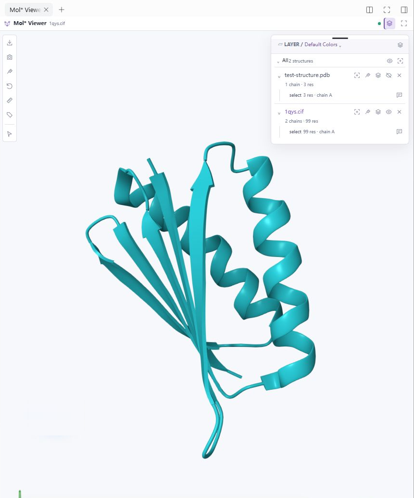

# DSH Molecular Workspace

[](LICENSE)
[](https://github.com/deepseek-ai)

A native 3D molecular viewer for the [DeepSeek Harness](https://github.com/deepseek-ai) right sidebar, built on [Mol*](https://github.com/molstar/molstar). The sidebar and the Agent share one Molecular Context Service, so a selection you make with the mouse is the same object the Agent manipulates, and a command the Agent issues lands on the canvas you are looking at.

[中文说明](README.zh-CN.md)



## What it does

Load a local PDB or mmCIF file, or a four-character PDB ID, and inspect it in the sidebar without leaving the conversation. Select residues, chains, or single atoms; focus on a binding site; measure real geometry; take a publication-ready image; or hand the current selection to the Agent as a reference in your next message.

The plugin is deliberately honest about what it does not know: contacts shown around a focused residue are geometry-inferred proximity, not interaction energies, and no figure it produces is an experimental conclusion.

## Features

**Structure handling**
- Load local PDB/mmCIF files or a PDB ID; multiple structures at once, each with its own representations, tags, and layers.
- Cartoon, Molecular Surface, ball-and-stick, spacefill, and others can be shown on the same structure simultaneously.
- Seven style presets — Default, Research, Cinematic, Cartoon, X-Ray, Craft, Origami — with real geometry, material, and renderer parameters, plus a Reset that rebuilds from Mol* defaults.

**Selection and inspection**
- Left-click to select and focus. Granularity switch between residue, atom, and chain; atom mode preserves model, auth/label numbering, atom name, altLoc, and unit/operator.
- Focus shows true ball-and-stick detail for the target, complete residues within 5 Å, and Mol*-inferred non-covalent contacts.
- Sequence strip with drag and shift-extend selection; click empty canvas to return to Overview.
- Undo for scene edits. Removing residues hides them from the view without modifying the source file.

**Measurements and annotations**
- Distance, angle, dihedral, plane, orientation axes, and free labels, all computed from actual atom coordinates. Each one can be restyled, hidden, or removed independently.
- Named tags and coloured layers that survive representation changes.

**Output**
- PNG/JPEG up to 8K, including transparent PNG.
- Selection export to mmCIF.
- WebM video with frame-range selection, 1080p/4K/custom sizes, 24/30/60 fps. MP4 is probed first and marked unavailable when the environment cannot produce valid frames.
- Trajectory playback over multi-model files.
- Rigid alignment between two structures with RMSD and the transform matrix.
- Every export writes an `evidence` JSON next to the file it produced.

**Conversation integration**
- "Add to chat" and "Send selection to chat" insert a visible residue reference into the native composer without discarding your draft, and without auto-sending.
- Type `@` in the composer to search molecular references.

**Agent tools** — see [AGENT_TOOLS.md](AGENT_TOOLS.md). Eight tools (`molecular_load`, `molecular_get_state`, `molecular_select`, `molecular_focus`, `molecular_highlight`, `molecular_style`, `molecular_control`, `molecular_get_command`) operate on the same state the sidebar shows. If the viewer is closed, Agent commands request it for the current session and wait for the renderer to connect rather than reporting a fake success.

**Appearance** — follows the DSH theme; an explicitly chosen export background still wins for exports.

## Screenshots

| Focus with 5 Å neighbourhood | Style presets |
|---|---|
|  |  |


## Requirements

- DeepSeek Harness with the right-hand sidebar (`dsh-client-ui-sidebar-right`).
- The host API the plugin declares in `peerDependencies` (`@deepseek-ai/cordis`, `dsh-tools`, `dsh-typert-protocol`, `dsh-llm`).
- Node.js 20 or newer for building. Running the plugin needs no build, because `client.js` ships in this repository.

## Install

The plugin is installed as a local package in a DSH profile. A profile lives under `~/.dsh/profiles/<name>/`.

1. Clone this repository somewhere stable:

   ```bash
   git clone https://github.com/Protonhydrogen/dsh-mol-workspace.git
   ```

2. Add it to the profile's `package.json` as a linked dependency and register the bundle:

   ```json
   {
     "dependencies": {
       "dsh-mol-workspace": "link:/absolute/path/to/dsh-mol-workspace"
     },
     "dsh": {
       "profile": {
         "bundles": [
           "dsh-mol-workspace"
         ]
       }
     }
   }
   ```

   The dependency key, the bundle entry, and the `name` in this repository's `package.json` must all stay identical: `cordis.patch.yml` inserts that id and the client module id inside `client.js` matches it.

3. Install the profile dependencies and restart DeepSeek Harness:

   ```bash
   cd ~/.dsh/profiles/<name>
   pnpm install
   ```

   The host half is ESM and is cached, so a full restart of DSH is required for changes to take effect.

4. Open the right sidebar and pick **Mol* Viewer**.

The sidebar state is stored per session under `~/.dsh/storages/molecular-workspace`, or wherever `DSH_MOLECULAR_STATE_DIR` points.

## Build from source

The shipped `client.js` is a single-file bundle with Mol* compiled in, so you only need this if you change `src/`.

```bash
npm install          # molstar + esbuild, as devDependencies
npm run build        # rewrites client.js
```

`build.mjs` resolves its toolchain through `tests/paths.mjs`, which honours `MOLSTAR_ROOT` when you keep dependencies outside the repository:

```bash
MOLSTAR_ROOT=/path/to/a/dir/with/molstar/and/esbuild npm run build
```

The build is not byte-for-byte reproducible across machines: esbuild records its own relative module paths, so a bundle built in a different directory differs in those path strings while the code stays identical.

## Tests

Unit tests run in plain Node and cover state, geometry, remote manifest, tool registration, and export helpers:

```bash
npm test
```

Live tests drive the real Mol* renderer in a browser and need a page to drive:

```bash
node tests/build.mjs
node --experimental-loader ./tests/resolve-loader.mjs tests/browser-server.mjs
# open http://127.0.0.1:43130/ in a browser, then:
npm run test:live
```

`tests/paths.mjs` locates `molstar` and the `@deepseek-ai/*` packages from the repository itself, the local DSH profile, or `MOLSTAR_ROOT` / `DSH_ROOT`. It fails with an explanatory message rather than a stack trace when one is missing. The test server binds `127.0.0.1` only.

Checked-in fixtures: `fixtures/1qys.cif` (PDB entry 1QYS) and `fixtures/test-structure.pdb` (a three-residue alanine/serine/glycine peptide).

## Project layout

```
index.js              host entry: service, typert registration, tools
src/host/             Molecular Context Service, persistence, projections
src/client/           sidebar UI, composer references, viewer wake-up
src/viewer/           Mol* engine adapter, selection, styles, exports
src/shared/           contracts shared by host and client
tests/                unit and live tests, browser harness
verification/         acceptance notes and rendered screenshots
cordis.patch.yml      bundle insertion for the DSH profile
```

## Limitations

- Contacts around a focus are geometric inference, not interaction energies or binding affinities.
- MP4 export depends on an encoder being present; when it is not, the option is disabled and WebM remains available.
- The composer only supports `@` and `/` triggers. This plugin does not modify DSH core to add `#`.
- Pre-1.0: the Agent tool surface may change between minor versions.

## License

[MIT](LICENSE). Built on [Mol*](https://github.com/molstar/molstar) (MIT), [zod](https://github.com/colinhacks/zod) (MIT), and [React](https://react.dev) (MIT).
