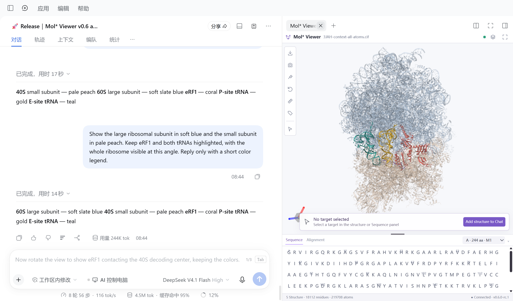
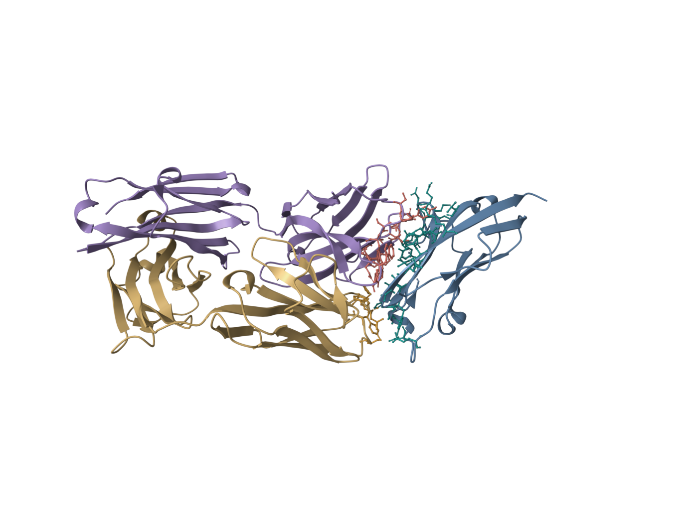
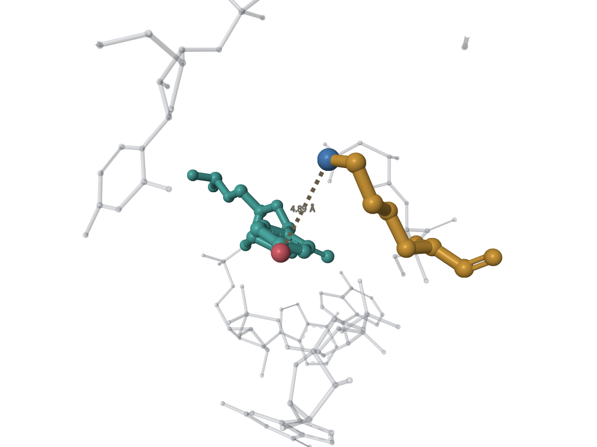
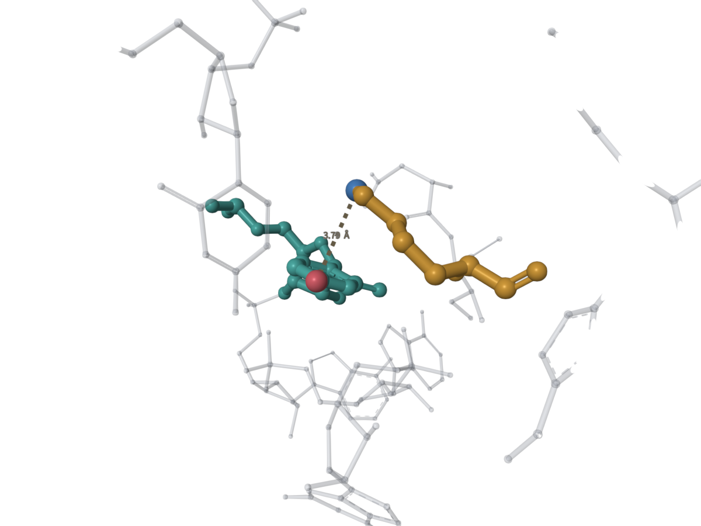

# DSH Molecular Workspace



真实 DSH 界面：通过自然语言给已加载的 3JAH 核糖体着色，60S 为柔和蓝色、40S 为浅桃色，eRF1 与两条 tRNA 保持高亮。可见请求没有相机坐标；截图隐藏了工作区名称。

[English](README.md) · [MIT 许可证](LICENSE)

基于 [Mol*](https://github.com/molstar/molstar) 的 DeepSeek Harness 右侧栏原生 3D 分子查看器。侧栏和 Agent 共用同一个 Molecular Context Service：你用鼠标做的选区，就是 Agent 操作的对象；Agent 发出的命令，落回你正在看的那块画布。



[PD-L1 / atezolizumab Fab（PDB 5X8L）](https://www.rcsb.org/structure/5X8L)。蓝色为抗原，紫色和金色为抗体重链与轻链，互作界面以球棍突出。新版包含柔和全抗原静电势预览和完整核糖体背景示例。

## 能做什么

载入本地 PDB/mmCIF 或四字符 PDB ID，不离开对话就能在侧栏里查看结构：选中残基、链或单个原子，聚焦结合位点，测量真实几何量，导出成图，或把当前选区作为引用交给 Agent。

插件对自身能力边界是诚实的：聚焦残基周围的接触线是几何推断的邻近关系，不是相互作用能；它产出的图也不是实验结论。

## 主要功能

- **结构**：多结构并列，每个结构独立的表示法、标记和图层；Cartoon、Molecular Surface、球棍等可同时显示；七种样式预设（Default、Research、Cinematic、Cartoon、X-Ray、Craft、Origami）与从 Mol* 默认值重建的 Reset。
- **选择**：左键选中并聚焦；残基/原子/链三档粒度，原子模式保留 model、auth/label 编号、原子名、altLoc、unit/operator；聚焦显示真实球棍细节、5 Å 内完整残基与非共价接触；序列条支持拖选与 Shift 扩选；场景编辑可撤销，隐藏残基不改源文件。
- **表面与静电**：溶剂可及表面（按溶剂探针半径外扩的高斯表面，水为 1.4 Å，探针半径与平滑度可调），与溶剂排除表面并列可选；静电势主题（原子中心处的屏蔽库仑势，正蓝负红），电荷优先取自 PDBQT 文件，否则用内置残基模型（骨架 Amber 电荷 + 侧链形式电荷）；介电常数、离子强度（Debye 屏蔽）、色阶范围均可调；任何选区都能作为图层单独携带溶剂表面或静电着色，不影响结构其余部分。
- **聊天指令**：molecular_surface 支持分子、Gaussian、范德华、溶剂可及四种表面。可用匹配坐标的 APBS OpenDX 网格，也可生成标注的侧链近似预览。指定残基和半径后只给完整表面的局部着色。持久高亮为小分子或残基建立独立球棍图层。
- **测量**：距离、角度、二面角、平面、主轴、标签六种，全部来自真实原子坐标，可独立改样式、隐藏、移除；命名标记与彩色图层在切换表示法后仍在。
- **导出**：PNG/JPEG 最高 8K、透明 PNG；选区导出 mmCIF；WebM 视频（可选帧区间，1080p/4K/自定义，24/30/60 fps，MP4 先探测编码器，不可用时标记为不可用）；多模型轨迹播放；两结构刚性比对（RMSD + 变换矩阵）。每次导出都在产物旁写一份 evidence JSON。
- **对话**：「加入对话」把可见的残基引用插入原生输入框，保留原草稿、不自动发送；输入 `@` 可搜索分子引用。
- **Agent**：9 个工具，详见 [AGENT_TOOLS.md](AGENT_TOOLS.md)。侧栏关闭时，Agent 的加载与视觉命令会为当前会话请求打开并等待渲染器连接，不会谎报成功。
- **外观**：跟随 DSH 主题；显式设置的导出背景优先。

## MD：在环境中观察单一关键互作

这个 60 帧 MD 观察子集突出两枚完整残基，只跟踪一条原子间距离。周围结构保留为半透明灰色，便于观察运动，避免多条接触线争夺注意力。

| 第 1 帧 · 4.89 Å | 第 34 帧 · 3.79 Å |
|---|---|
|  |  |

[观看 MD 播放视频（WebM）](https://github.com/Protonhydrogen/dsh-mol-workspace/releases/download/v0.6.0-rc.1/md-single-contact.webm) · [下载视频](verification/md-single-contact.webm)

图片和视频使用真实模拟的采样坐标，虚线标注几何距离。本次只公开这些查看器导出媒体；原始拓扑、轨迹和包含本地路径的证据文件仍保留在本地。

## 安装

本插件以本地包的形式装进 DSH profile（`~/.dsh/profiles/<名称>/`）。

1. 克隆仓库到一个固定位置。
2. 在 profile 的 `package.json` 里加链接依赖并注册 bundle：

   ```json
   {
     "dependencies": {
       "dsh-mol-workspace": "link:/仓库的绝对路径/dsh-mol-workspace"
     },
     "dsh": {
       "profile": {
         "bundles": ["dsh-mol-workspace"]
       }
     }
   }
   ```

   依赖键名、bundle 条目与本仓库 `package.json` 里的 `name` 三者必须一致：`cordis.patch.yml` 插入的就是这个 id，`client.js` 里的模块 id 也与之一致。

3. `cd ~/.dsh/profiles/<名称> && pnpm install`，然后**完整重启** DSH（宿主端是 ESM，有缓存）。
4. 打开右侧栏，选择 **Mol* Viewer**。

会话状态保存在 `~/.dsh/storages/molecular-workspace`，可用 `DSH_MOLECULAR_STATE_DIR` 改位置。

## 构建与测试

仓库已包含构建好的 `client.js`（Mol* 已打进去），**使用不需要构建**。只有改动 `src/` 才需要：

```bash
npm install      # 安装 molstar + esbuild（devDependencies）
npm run build    # 重新生成 client.js
```

可以用 MOLSTAR_ROOT 指向外部依赖目录。构建会规范化模块名，避免将构建机路径写入公开产物。

单元测试（纯 Node）：

```bash
npm test
```

浏览器实测（需要真实渲染器）：

```bash
node tests/build.mjs
node --experimental-loader ./tests/resolve-loader.mjs tests/browser-server.mjs
# 浏览器打开 http://127.0.0.1:43130/，然后：
npm run test:live
```

测试服务只监听回环地址。`tests/paths.mjs` 会从仓库自身、本机 DSH profile 或 `MOLSTAR_ROOT` / `DSH_ROOT` 找到依赖，找不到时报出该装什么，而不是丢一个栈。

## 目录

```
index.js             宿主入口：服务、typert 注册、工具
src/host/            Molecular Context Service、持久化、投影
src/client/          侧栏 UI、输入框引用、查看器唤醒
src/viewer/          Mol* 引擎适配、选择、样式、导出
src/shared/          宿主与客户端共享的契约
tests/               单元与实测脚本、浏览器 harness
verification/        验收说明与渲染截图
```

## 已知边界

- 聚焦处的接触是几何推断，不是相互作用能或结合亲和力。
- MP4 依赖环境里有可用编码器；没有时该选项不可用，WebM 仍可用。
- 输入框只支持 `@` 和 `/` 触发；本插件不修改 DSH 核心去加 `#`。
- 原有静电主题在原子中心计算近似屏蔽库仑势。molecular_surface 可以在表面顶点直接采样 APBS OpenDX 数据。没有网格时，该命令显示近似势。
- 溶剂可及表面是按探针半径外扩的高斯近似，不是 Connolly 滚动探针构造。
- 1.0 之前，Agent 工具面可能在次版本间变化。

## 许可证

客户端捆绑的库见[第三方许可证声明](THIRD_PARTY_NOTICES.txt)。

[MIT](LICENSE)。基于 [Mol*](https://github.com/molstar/molstar)（MIT）、[zod](https://github.com/colinhacks/zod)（MIT）与 [React](https://react.dev)（MIT）。

## 新版示例与轨迹

- [PD-L1/抗体和完整核糖体示例](examples/README.md)：官方坐标、界面接触、柔和的完整抗原静电势预览、保留灰色环境的 A/P/E 位点。
- [可直接发送给 DSH 的复现提示词](examples/DSH_PROMPTS.md)。
- [DCD/XTC 轨迹导入与性能边界](docs/MD_TRAJECTORIES.md)：匹配拓扑、轻量显示、单次帧提交、暂停/拖帧，以及随帧变化的关键接触测量。
- 公开图均直接从查看器导出；个人研究轨迹和带本机路径的原始证据不包含在公开包内。